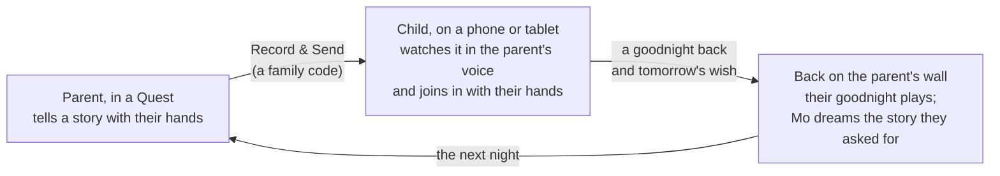
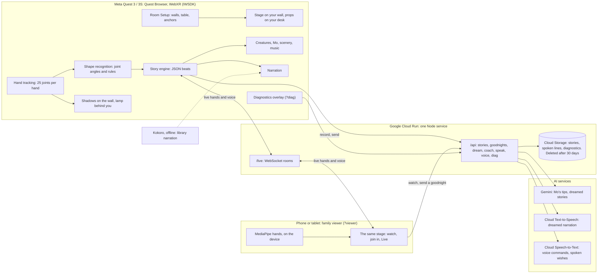

# Bedtime Across the World

**Bedtime stories told with your hands, for a child who is far away.**

Hands only, no controllers. Seated. Works on any wall, or none.

<!-- Hero image: docs/hero.jpg, a still from the headset capture (added after the device sessions). -->

A parent puts on a Meta Quest and tells a shadow-puppet story on their own wall:
a virtual lamp behind them throws the shadows of their real, tracked hands, and when
they make a rabbit, a fish or a bird, the shadow comes alive in colour and carries
the story on. Their child, at home on a phone or tablet, watches it, plays along
with their own hands through the camera, and sends a goodnight back, with a
drawing and new colours for Mo.

For the soldier on deployment, the parent working in another country, the
grandparent across an ocean.

Built with [IWSDK](https://iwsdk.dev) (WebXR) for the Meta VR Start Developer
Competition 2026 (Entertainment track, New Experience division).

## Built on real Quest hardware, not just the emulator

Bedtime Across the World was played and tuned on a **Meta Quest 3** and a **Meta Quest 3S**,
in a real room, with hand tracking only. Every headset session ran with
privacy-safe diagnostics (`?diag`), so each problem was found in the numbers,
fixed, and checked again on the headset.

**Tested on** Meta Quest 3 · Meta Quest 3S · iPad (Safari and Chrome) · a computer · an iPhone.

| On Meta Quest 3 or Quest 3S (Quest Browser) | |
| --- | --- |
| Play it | https://bedtime-across-the-world-1031148889398.us-central1.run.app |
| Play it with live diagnostics on screen | https://bedtime-across-the-world-1031148889398.us-central1.run.app/?diag |

**Meets the 60 fps minimum on both headsets: 72 Hz held in all 15 sessions.**
Median 71.5 to 72 fps · frame time (95th percentile) 14.7 to 15.5 ms, where 60 fps
allows 16.7 · **1 of 1,754** five-second windows under 60 fps: the first five
seconds of one session, entering XR (47 fps). The 37 windows while the headset
itself slept, woke or showed its menu are counted apart.

**The device sessions (the evidence).** Each `?diag` session has an anonymous
id; its raw data is in [`docs/diag/`](docs/diag) (frame times, hand tracking,
room detection, story beats; never audio, video, names or codes). Check any
number here with `node scripts/diag/summarize.mjs docs/diag`.

<details>
<summary><b>All 15 headset sessions</b>: what was played in each, its frame rate and its data</summary>

| Session | Headset | Started (UTC) | In the headset | What was played | fps (median, lowest 5 s) | Frame p95 |
| --- | --- | --- | --- | --- | --- | --- |
| [`cdj3st58rm`](docs/diag/2026-11-14/cdj3st58rm.jsonl) ([part 2](docs/diag/2026-11-15/cdj3st58rm.jsonl)) | Quest 3 | Nov 14, 22:56 | 12 min | Counting Stars: 12 minutes waiting on the opening bird, made the textbook way (the evidence behind recognising shapes as people really make them) | 71.8, 46.9 | 15.0 ms |
| [`49768whrpd`](docs/diag/2026-11-15/49768whrpd.jsonl) | Quest 3 | Nov 15, 02:20 | 26 min | Counting Stars, The Brave Little Dog, The Night Garden and The Letter That Took the Slow Way (the opening bird in 22 s, then 6 s). Only its last half minute (16:28) survives in `docs/diag`: the rest was overwritten when the page was reopened, a server bug now fixed, so the numbers here are that half minute's | 72.0, 61.1 | 15.5 ms |
| [`32kbw476u2`](docs/diag/2026-11-15/32kbw476u2.jsonl) | Quest 3S | Nov 15, 07:19 | 0.3 min | A dreamed story; stage found on a labelled wall (27 room planes) | 71.4, 68.0 | 16.2 ms |
| [`xhz96jhkv9`](docs/diag/2026-11-15/xhz96jhkv9.jsonl) | Quest 3 | Nov 15, 16:28 | 4.6 min | Two dreamed stories, each to The End | 71.6, 67.4 | 14.8 ms |
| [`xnhuwf56d6`](docs/diag/2026-11-15/xnhuwf56d6.jsonl) | Quest 3S | Nov 15, 16:38 | 0.6 min | The Night Garden | 71.5, 68.3 | 15.5 ms |
| [`afthmamdpn`](docs/diag/2026-11-15/afthmamdpn.jsonl) | Quest 3S | Nov 15, 16:39 | 8.4 min | The Night Garden, The Moth, Mo and the Midnight Moon Buggy (to The End), Goodnight Across the Sea | 71.6, 67.5 | 14.8 ms |
| [`m3zdndu6vq`](docs/diag/2026-11-15/m3zdndu6vq.jsonl) | Quest 3 | Nov 15, 19:25 | 11.7 min | A dreamed story, Moon Buggy, Sleepy Little Dinosaur and Little Lost Spaceship, each to The End; six of Mo's AI tips in 0.6 to 0.9 s | 71.8, 70.4 | 14.8 ms |
| [`8b2ca94jd3`](docs/diag/2026-11-16/8b2ca94jd3.jsonl) | Quest 3 | Nov 16, 06:47 | 16.2 min | Four stories dreamed from ideas said aloud, each written in 4 to 11 s; Moon Buggy and Sleepy Little Dinosaur | 71.6, 46.9 (the first 5 s, entering XR) | 14.9 ms |
| [`g3bb9hvnvt`](docs/diag/2026-11-16/g3bb9hvnvt.jsonl) | Quest 3S | Nov 16, 07:04 | 16.4 min | Goodnight Across the Sea, Little Lost Spaceship, Moon Buggy and a dreamed story | 71.8, 66.8 | 14.9 ms |
| [`fpxa7ky672`](docs/diag/2026-11-16/fpxa7ky672.jsonl) | Quest 3 | Nov 16, 16:43 | 11.0 min | The stage on a real wall 1.66 m away (Room Setup's bedroom scan); The Moth and two dreamed stories | 71.6, 67.6 | 14.9 ms |
| [`r9w45r8ghs`](docs/diag/2026-11-16/r9w45r8ghs.jsonl) | Quest 3 | Nov 16, 16:54 | 1.8 min | Launched again: the stage came back to the same spot on the wall | 71.8, 65.9 | 14.7 ms |
| [`9f89mnu4ye`](docs/diag/2026-11-16/9f89mnu4ye.jsonl) | Quest 3S | Nov 16, 17:13 | 15.7 min | On the wall, the desk props on the real desk; a dreamed story, Moon Buggy, Little Lost Spaceship and Sleepy Little Dinosaur | 71.6, 63.5 | 14.9 ms |
| [`v7sw83fr98`](docs/diag/2026-11-16/v7sw83fr98.jsonl) | Quest 3S | Nov 16, 18:44 | 11.2 min | Back on last time's wall; Moon Buggy, The Moth and a dreamed story | 71.8, 62.5 | 14.9 ms |
| [`4zp7d8t7yg`](docs/diag/2026-11-17/4zp7d8t7yg.jsonl) | Quest 3 | Nov 17, 00:34 | 19.3 min | Every story-world creature woken with real hands: rocket, alien, asteroid, shark, octopus, whale, car, aeroplane, digger, T. rex and pterodactyl, across six stories and a dream; two recordings saved and sent | 71.6, 66.8 | 15.0 ms |
| [`ufckcgf798`](docs/diag/2026-11-17/ufckcgf798.jsonl) | Quest 3 | Nov 17, 06:31 | 16.6 min | A first launch on the new address (Counting Stars: the bird 32 s after Enter XR); The Shy Little Shark, every shape in 2 to 7 s and the whale carried to the lighthouse in under a second; The Sleepy T. rex; a dreamed story with four creatures; The Little Car's Long Way Home, recorded with the voice and sent | 71.6, 67.2 | 14.9 ms |

</details>

**What real hands and real rooms taught us**: found on the headsets, fixed, tried again.

| On a real Quest | Before | After |
| --- | --- | --- |
| The opening bird (people hook their thumbs and relax their fingers) | 15 min | **6 s** |
| Natural hand positions that cast a shadow (modelled) | 2% | **80%**: the lamp moved behind you |
| "Open your hands" (people open them flat) | 75 s | **any open hand counts** |
| Carrying the whale to the lighthouse | up to 45 s | **0.8 s** |
| A shape still missing after a minute | given up | **help at 15, 30 and 45 s** |
| The stage in a room with ten walls | a paper screen | **on the real wall**, and back on the same spot next launch |
| A parent reading the lines aloud | cut off by the next caption | **each line waits for the reader** |
| The car, in the lamp's orange light | could not be seen | **red**, and every colour tested against the light |

<details>
<summary><b>Everything else the headsets taught us</b></summary>

| On the headset | What changed |
| --- | --- |
| Hands were in the lamp's light only about 15% of the time: the desk lamp stood where hands are naturally held, so shadows meant reaching far forward to a window about 14 x 9 cm | **The lamp moved behind you**, as in real shadow theatre, aimed once through your own hands: modelled over natural hand positions, 80% now cast their shadow on the stage (it was 2%) |
| The opening bird took 15 minutes: real birds are made with thumbs hooked and fingers relaxed, not the textbook pose | Shapes recognised **as people really make them**: hooked-thumb birds, relaxed fish, tilted snails, palms-up cupped hands, two-finger antlers. The same bird then woke in 6 seconds |
| A shape still missing after about a minute was given up | The story helps sooner, at 15, 30 and 45 seconds, and after 45 any hand held still in front of you wakes the creature |
| "Open your hands" waited 75 seconds: people open their hands flat, fingers together | Any open hand counts |
| Entering from the Quest's own Enter VR prompt kept every sound back for the first 50 seconds | The story waits on its line and asks for one pinch to turn the sound on |
| Creature voices were played but not heard over the room, while the narrator was | Each voice is now a small sound file, played exactly like the narration and as loud |
| The narrator read "Shh" as the letters S-H-H | Lines are written for the voice ("Hush") |
| Two narration lines could overlap when a shape was made mid-sentence; creatures on the desk bumped into each other; a dreamed fish swam through a forest | One line at a time; creatures stand side by side; a dreamed story moves to where each creature belongs |
| The stage stood on the paper screen in a room with ten walls, and nothing said why | The diagnostics now name why each wall was passed over: Room Setup had scanned another room. With the bedroom scanned, the stage stood on the real wall, and came back to the same spot on the next launch |
| "Raise an open hand to go on" waited 8 to 21 s: a palm raised toward the wall is flat, fingers together | Any open hand in the light counts |
| Making a creature bigger meant pulling the hand back almost to the chin; both of The Moth's grow steps waited for the 30 s help | About 12 cm of pull toward the chest is enough |
| Hands put down between shapes still threw their shadows on the wall | A lowered hand casts no shadow until it is raised again |
| A shape said aloud went straight to the desk without carrying Mo; a hand held up nearby took the creature over | A spoken creature crosses the wall by itself and carries Mo; only a hand making its shape takes it over |
| A dreamed story asked for "a fish and a crocodile" came back with a dog; a fourth shape was dropped; its rabbit took 25 s (The Moth's: 2.4 s) | Any creature an idea names, up to four, with the library's easier poses (two fingers up for the rabbit) |
| A T. rex and a pterodactyl asked for in a dream were left out, and Mo's tips for the new creatures were the app's fixed words | Dreams, voice commands and Mo's tips know every story-world creature, each dreamed in its own world's place |
| Carrying a whale or a snail toward the lighthouse took up to 45 s: they were asked to rise like a bird, and a fist pose turned toward it stopped reading as itself | Only fliers rise; the whale and snail carry a shorter way |
| A recording played on the headset had to be watched to the end: the lamp switch and the Journal answered only the recording's hands | Your own hands still pinch the switch and the Journal while a recording plays |
| On an iPad, Join in lost the recorded voice after the first shape: iOS would not start it again without a tap | The voice is muted, never paused, between lines, so it comes back |
| A child's drawing from a goodnight stayed on the wall in every story, over the creatures | It walks on once, stays a moment, and hops off |
| Most endings let the light go onto a wall that did not change (only the lighthouse lit up) | The released light comes home into the scene: stars come out, fireflies rise, the river's moon lays a silver path |
| The car woke but could not be seen: its yellow vanished in the lamp's orange light | The car is red; a test checks every creature's colour against the lamp light (it also caught the alien's lime) |
| The digger took 31 s: the story asks for "a scoop", and people make one with curled fingers, which read as cupped hands | A scooped hand counts while a digger is asked for |
| A dreamed story's fourth creature pushed the first off the desk | Four places, on the desk and on the family's shelf |
| Send to family looked stuck on a long story, so it was pressed again: sent twice, with two family codes | The button says "Sending...", a second press is ignored, and the voice is recorded at speech quality (about a quarter of the size) |
| On a phone or tablet, joining in to a recording made straight after another story went back to its start after the child's turn | The story goes on from the turn |
| A parent reading the lines aloud was cut off mid-sentence: the next caption came on reading time alone, and the recording kept the cut | Recording with your voice, each line waits until you pause |
| A dreamed story began at once, with no moment to press Record | It waits on its title: **Tell it**, or **Record and tell it** |
| On an iPad a creature's voice silenced the storyteller's recorded voice, and full screen while joining in turned the camera off | Creature voices on the family viewer no longer stop the recorded voice; the camera carries on through full screen |

</details>

The room side works on real Room Setup data: the stage finds a labelled wall
(or falls back to a floating paper screen) and the desk props stand on the
detected table, anchored so they are in the same place the next time. Both
were seen on the headsets on Nov 16: the stage on a real wall in four sessions,
and back on the same spot when the app was launched again (`r9w45r8ghs`,
`v7sw83fr98`).

**How the diagnostics work.** Opening the app with `?diag` adds a small overlay
and sends anonymous technical data: frame times, the quality level, hand
tracking and what the recognizer saw (including the measurements behind each
two-hand shape), room detection, story timings and the sound engine's state.
Never audio, video, names or family codes. `scripts/diag/pull.sh` turns a
session into a one-screen report: how long each request took, how often hands
were in the light, whether sound was running.

## Try it

| | |
| --- | --- |
| In a Meta Quest browser | https://bedtime-across-the-world-1031148889398.us-central1.run.app (press **Enter XR**, or install it as an app from the browser menu: it then opens straight into the headset view) |
| Family viewer (phone, tablet, desktop) | https://bedtime-across-the-world-1031148889398.us-central1.run.app/?viewer |

A first launch opens *The Shy Little Shark*: every shape in it is one easy
hand (a shark, an octopus, a whale), then cupped hands.

On first launch both sides come with a labelled sample family, so you can try
everything alone: the viewer has a story *from Dad* to watch and join in, and the
headset has a goodnight *from Mia* waiting (pinch the Shadow Journal on the desk,
then **Goodnights**).

### Your first minute

1. Open the link in the Quest Browser, press **Enter XR** and allow room access
   (it finds your wall and your desk).
2. **Keep the room lights on.** Bedtime Across the World dims the room for you, and hand
   tracking needs light.
3. Put the controllers down. The lamp stands behind you, as in shadow theatre:
   hold a hand up in front of you, where it is comfortable, and Mo the moth
   follows your fingertip (the light settles to shine through your hands).
   When asked, make the shape the ghost hand shows and hold it a moment; the
   shadow comes alive. If you hear nothing, pinch once: the headset may be
   holding sound back.

Two fallbacks: with no wall straight ahead, the story plays on a floating paper
screen; if the stage lands somewhere odd, pinch the book on the desk, then
**Move stage here**, and look at the wall you want. If a shape will not come,
the story helps: after 15 and 30 seconds it is more forgiving, and after 45 any
hand held still in front of you will do.

## What it does



| In the headset: the storyteller | On a phone or tablet: the family |
| --- | --- |
| **Shadow puppets on your real wall**: make a shape, it comes alive | **Watch** the story in the storyteller's own voice |
| **17 hand shapes, 20 creatures**, read as people really make them | **Join in**: the story waits for the child's hands (camera) |
| **19 stories** in five worlds, and stories **Mo dreams** for you | **Send a goodnight back**: a shadow creature, a drawing, Mo's colours |
| **Record & Send**: a private family code, no accounts | **Ask for tomorrow's story**: say it, type it, or pick pictures |
| **Go live**: tell it together, in real time, taking turns | **Night light**: Mo asleep under the stars as they drift off |
| **Hands only**, seated; Look to press and Voice commands for no hands | Phone, tablet or computer, in the browser: nothing to install |

<details>
<summary><b>Every feature, in detail</b></summary>

**In the headset (the storyteller)**
- A stage on your real wall, found from the room's detected planes (a floating
  paper screen when there is no usable wall, and **Move stage here** to put it
  where you look), with the room dimmed like a theatre and a twilight sky in
  each world's and scene's colours glowing behind the shadows.
- **The lamp is behind you**, as in shadow theatre: it stands on a small table
  behind your shoulder and is aimed once through your own hands, so a hand held
  where it is comfortable throws its shadow onto the stage (its switch is on
  the desk: pinch it to pause). Pull a hand back toward your chest and its
  creature grows; in a search, the light follows your hand like a torch.
  Hands put down between shapes cast no shadow.
- **Creatures come alive**: in their own colour, with fireflies leaving the wall,
  a little voice each (a chirp, a bubble, a soft woof), and a quiet music-box
  lullaby under the story (**Music** in Settings). Mo flies off the wall and
  lands on your fingertip, and at the end falls asleep there. When you let a
  creature go, a glowing paper cut-out of it hops onto your desk. At the finale
  a window opens in the wall onto hills under the stars, and the light you let
  go comes home into the scene: stars come out one by one, fireflies rise from
  the meadow, the river's moon lays a silver path, the lighthouse wakes. Every
  story told to the end leaves a star in a jar beside the journal, kept from
  night to night.
- Nineteen narrated stories in five **story worlds** (*Where should we go
  tonight?*), picked from the journal, each world with its own colours, sky
  and creatures:
  - *Wonder and Nature*: *The Moth Who Borrowed Light* (twenty minutes in
    chapters, a branching wolf encounter, a lighthouse finale), *The Letter
    That Took the Slow Way*, *The Brave Little Dog*, *Counting Stars* (three
    minutes, for the littlest ones), *The Night Garden*, *The Kind Crocodile*
    and *The Little Rainstorm*;
  - *Ocean and Exploration*: *Goodnight Across the Sea*, from the shore with a
    swan to a lighthouse, *The Shy Little Shark* and *The Little Whale's Song*
    (a shark, an octopus, a whale);
  - *Cars and Adventure*: *Mo and the Midnight Moon Buggy*, on a moon road,
    *The Buggy's Bumpy Road* and *The Little Car's Long Way Home* (a car, an
    aeroplane, a digger);
  - *Dinosaurs and Discovery*: *Mo and the Sleepy Little Dinosaur*, in a fern
    valley under a smoking volcano, *The Sleepy T. rex* and *The Pterodactyl's
    Sky Ride*;
  - *Space and Exploration*: *Mo and the Little Lost Spaceship*, at a star port
    under a ringed planet, *Mo and the Sleepy Space Rocks* and *The Aliens'
    Lullaby* (a rocket, an alien, an asteroid).

  Each world opens with a story of its own creatures (the shark, the car, the
  T. rex, the rocket), and the journal's creatures page keeps every one met.

  The newer stories each have their own narrator. Seventeen hand shapes, from
  a rabbit to a two-handed crocodile, a rocket (one finger up) or a whale (a
  fist, thumb up), recognised as people really make them; a world's own poses
  are read only while its stories ask for them. The story never fails: it
  shows a ghost hand for every shape, waits, and becomes more forgiving.
- **Record a story** (hands, story and your voice: you are the narrator, the
  captions are your script) and **Send to family**: a private family code
  (three words and a number, like `lantern-otter-moss-417`), no accounts. Every
  recording is kept on the headset and listed in the journal with its family
  code once sent, to replay on the wall or pick which one to send. While a
  recording plays, your own hands still pinch the lamp switch to pause and the
  journal to stop. Read the captions aloud at your own pace: while you record
  with your voice, each line waits until you pause. Record pressed before the
  story's first shape starts the story again from its title, so the recording
  has all of it; Send shows "Sending..." while it uploads.
- **Go live**: your family joins with the code and sees your shadows on their
  screen in real time; talk to each other; **Take turns** so the child makes
  every other creature, which wakes in the child's own colour with their name.
- **Goodnights**: what your family sent back plays on your wall (the journal
  steps aside for it); Mo takes the
  colours the child chose, and the creature they drew walks onto the wall at
  the start of the next story, then hops off.
- **A story the child asked for**: a goodnight can ask for tomorrow's story
  ("Dad, tell me a story about Mo at the carnival"). The journal's chooser
  shows "Mia asked: ..." and **Dream Mia's story**: Mo plans it into the
  closest place the app has scenery for (a carnival becomes "a little carnival
  in the meadow, under strings of lanterns"), shows the plan, and the
  storyteller can change the place or shapes before dreaming it. Mia's sample
  goodnight asks for one, so it can be tried alone.
- **Stories your child would like**: Mo keeps a small taste for each child on
  the headset (the places and creatures they asked for, made in their
  goodnights and were told, and their last few ideas) and suggests three new
  stories from it under "Mia might like": one close to what they love, one
  that mixes two of them, one gentle new thing.
- **Mia's bedtime, across the world**: once a goodnight has come, the
  journal's family section shows the child's time and how near their bedtime
  is: "It's 7:10 pm for Mia. Bedtime in about 20 minutes", or "Mia is asleep.
  Record one for tomorrow night." The usual bedtime is learned from when their
  goodnights are sent (7:30 pm until then). Mia's sample is at UTC+1.
- **Dream a new one** (Tonight's story): Mo dreams up a new short story for a
  place (sea, forest, meadow, river, rain, sky, or the worlds' space, road and
  dinosaur valley, with their own creatures) and two or three shapes the
  storyteller picks, in the order the story should ask for them. Or press
  **Say your idea** and ask in your own words: "I need a forest story with a
  dog and a rabbit" (the place and up to four creatures named are used, any
  of them, a T. rex or a whale too; Gemini picks whatever the idea leaves
  out, and lets the idea colour the story). The button reads **Done** while Mo
  listens and **Got it** once she has heard, and "Mo is dreaming up your
  story" shows under the stage, its dots moving, while it is written. With
  Voice commands on, the same sentence works without the button. Gemini writes the
  narration lines; the app builds the story itself (the same pattern as
  Counting Stars) and checks every line, so it plays like any other story, with
  captions and a narrator's voice that says the child's name. A dreamed story
  can be recorded and sent, or told live, like any other: its words travel with
  it, and the server and the family's device check them again before it plays.
  Once dreamed, it waits on its title with the journal open, at "Mo dreamed
  ...": **Tell it**, or **Record and tell it** (or say either).
- Accessibility: recognition tolerance, show-me hints, one-hand mode and a
  high-contrast mode (black-and-white panels and captions, solid shadows on the
  wall), and **Look to press** for limited hand mobility: rest the centre of
  your view on a button, the journal or the lamp switch to press it, and look
  at the ghost hand to make a shape, so a whole story can be told without hands
  (head gaze: Quest 3 and 3S have no eye tracking). **Voice commands** are the
  spoken alternative: say the shape the story asks for (its creature then
  crosses the wall by itself and carries Mo), "open the journal",
  "pause", "continue", "go on", "music off" or a button's name. One-hand mode,
  forgiving shapes, high contrast, Look to press and Voice commands are also on
  the first screen, before entering XR.
- Pauses when you open the Quest menu or take the headset off, and picks up on
  the same line; a story left mid-way continues from its chapter next time.
  If the headset holds sound back (it does when you enter from the Quest's own
  Enter VR prompt rather than the page's button), the story waits on its line
  and asks for one pinch to turn the sound on; with no pinch it goes on with
  captions after a few seconds.

**On the phone or tablet (the family)**
- Watch a story someone recorded for you, in their voice, with your name in it.
  What steps off the wall lands on a little shelf under the stage, as on the
  storyteller's desk: the glowing creatures, the keepsake jar, and Mo asleep
  at the end. Each story is listed by its name; **Full screen** where the
  browser allows it (computers, Android, iPad), and while a story plays from
  an icon in the top-left corner; the controls fade away while the story plays.
- **Join in**: at each shape the story waits for *your* hands (camera, after a
  grown-up allows it); the storyteller's recorded voice carries on around your
  turn, on iPads too, and the camera keeps going through full screen.
- **Join live** with a family code; talk, show your hands, take turns.
- **Send a goodnight back**: twenty seconds of your shadow creature (a classic
  shape, or one of the creatures from tonight's story, like the shark or the car) and, if a
  grown-up switches it on, your voice; choose colours for Mo, and draw a
  creature with your finger for the next story.
- **Ask for tomorrow's story** with the goodnight: say it (**Say it**), type it,
  or, for a child who cannot say it yet, pick a place and up to three
  creatures in pictures. A character from a show or a scary word is left out,
  and the grown-up sees what will be sent and why.
- **Night light**: at the end of a story (or once the goodnight is sent), the
  phone becomes a night light: Mo asleep on the moon under twinkling stars, a
  glow swelling around her, "Goodnight, Mia. Love, Dad", and the lullaby,
  softly. Over ten minutes the light and the music
  fade, then the screen goes dark and the phone may sleep (it is kept awake
  until then). A tap only shows a Close button, so a sleepy hand does not end
  it.

</details>

## How Bedtime Across the World uses AI

AI helps the storyteller; it never replaces them, never sees the child, and
never puts a word on the wall that the app has not checked.

| | What it does | What it is given | Guardrails |
| --- | --- | --- | --- |
| **Mo the coach** (Gemini 3.5 Flash Lite) | When a hand is stuck on a shape, Mo gives one short, warm tip in about 0.7 s ("curl your ring finger down") | Only the shape's name and a few fixed facts the headset worked out from the hand's joints | The facts come from the app's own recognition, not from the model; the reply must fit them, pass the content checks (no brands, Mo is "she", no pose from another shape), or the app's own words are used |
| **A child's request** (Gemini 3.5 Flash Lite) | Plans a story the child asked for into the closest place the app has ("the carnival" becomes a carnival in the meadow), with shapes that fit, shown to the storyteller before it is dreamed | The child's words (softened on the phone: characters from shows and scary words left out), a place and creature names | Only when the storyteller presses Dream; the place and shapes come from fixed lists; the setting is one checked plain line. Without the model, a table of common ideas (carnival, pirates, castle, snow...) does the same |
| **Stories your child would like** (Gemini 3.5 Flash Lite) | Three story ideas from a child's taste, each with why they would like it | Counts of places and creatures, and the child's last few ideas (softened). Never a name | Every field is checked (fixed lists, plain lines, no characters, no he or she); ideas that fail are dropped; without the model, ideas made from the taste itself. The taste stays on the headset |
| **Dream a new story** (Gemini 3.8 Flash) | A new bedtime story for the place and shapes the storyteller picks, or for an idea said in their own words ("a forest story with a dog and a rabbit"), in about 4 s | A theme and shape names; with **Say your idea**, the words said (plain words only, at most 30, checked first; brands and never-say words are dropped and not sent) | The model writes only lines of narration into a fixed shape; the app builds the story itself (scenes, requests, scenery that fits each creature), checks every line, and refuses anything off. Shared, it is checked again by the server and the family's device |
| **A voice for every line** | The library is read by five narrators recorded offline with **Kokoro**, an open model (Apache-2.0); a dreamed story is read live by **Google Cloud Text-to-Speech**, saying the child's name | Story lines only | Only plain story lines that pass the content checks are spoken; each is cached and deleted after 30 days. When a parent records, *they* are the narrator |
| **Voice commands** | Say the shape, "pause", "go on", "music off" | A spoken phrase of a second or two (the browser's own recognition, else **Google Cloud Speech-to-Text**) | Only on when switched on; the clip is forgotten; ignored while recording or talking live |
| **The child's hands** | The family viewer turns the phone's camera into hand positions with **MediaPipe**, on the device | Camera frames, on the device only | Video never leaves the device; a grown-up allows the camera first |

What is *not* AI: the hand-shape recognition in the headset is the app's own,
joint angles matched to templates and rules tuned on real headset sessions. It
is instant, works offline, explains itself (that is where Mo's facts come
from), and cannot be talked into a wrong answer.

The model provider is one setting on the server (`AI_PROVIDER`): Gemini for the
submission, with Claude and Meta's models also supported.

## Age rating: 10+

Bedtime stories meant to be shared by a grown-up and a child. The only peril is
gentle and resolves kindly: a wolf on the path runs away from a big shadow dog
or falls asleep under a shadow bird, a storm passes, a little dog is scared and
brave anyway. There is no violence, injury, frightening imagery, profanity,
romance, advertising or in-app purchase. The family side is set up by a grown-up,
who allows the camera and switches on the voice for a goodnight; shared stories
are private to the family and deleted after 30 days.

## Privacy and safety

- No accounts and no public listing. A shared story is reachable only by its
  private family code and is deleted after 30 days.
- The camera starts only after a grown-up allows it on that device. Video never
  leaves the device; only hand positions are used (and, in Live, sent).
- The microphone opens only when the person presses Record with voice, Talk or
  Say your idea (from the press until the idea is said, at most 10 seconds),
  or turns on Voice commands. With Voice commands on, a short spoken phrase is
  understood by the browser's own speech recognition or, where the headset
  browser has none, sent to a speech-to-text service and forgotten; commands
  are ignored while a story is being recorded with voice or during Talk.
- Mo's tips: when someone is stuck on a shape, the app sends the server only
  the shape's name and a few fixed facts about the hand pose ("the ring finger
  should be curled down"), never names, video, audio or free text. Where the
  server has AI enabled, Google's Gemini words Mo's tip from those; otherwise
  the app's own words are used. Nothing is stored.
- A dreamed story: the app sends a theme and shape names, and, only when the
  storyteller uses Say your idea, the words of their idea (turned into text as
  above). The server checks those words first (plain words, at most 30, no
  brands or never-say words, else they are dropped) and sends them to Gemini as
  an idea for the story, asking it to use no names from them; they are never
  stored, logged or put in the story. The story is kept on the device. Its lines are
  voiced by Google Cloud Text-to-Speech on the server; a line that names the
  child sends that first name with it. Each spoken line is kept in the story
  bucket by its words (not linked to any family) and deleted after 30 days.
- A goodnight's gifts travel with it, under the story's private code: Mo's
  colours as a palette name, and the child's drawing as finger strokes (a few
  kilobytes), both checked by the server.
- A story request travels the same way: the child's words (softened on the
  phone, checked again by the server), and any place and creatures picked in
  pictures, deleted with the story after 30 days. **Say it** opens the
  microphone only from the press until the idea is said, like Say your idea.
  The words reach the AI only if the storyteller presses Dream, to plan and
  write that story.
- A goodnight also carries the phone's offset from UTC (for example UTC+1),
  never a place or a time zone's name, so the storyteller sees the child's
  time. The headset keeps it, and the local times of the last seven
  goodnights, with the child's taste.
- A child's taste (counts of places and creatures, their last five ideas) is
  kept on the storyteller's headset only. To suggest stories, the counts and
  ideas are sent, never a name; nothing is stored on the server.
- Live rooms hold one storyteller and one family member. The server relays only
  protocol messages and stores nothing.
- Uploads are strictly validated; rate limits and room limits are per client.
- Diagnostics are off unless the page is opened with `?diag`; then it sends
  anonymous technical data (frame times, quality level, recognition results,
  room detection, device type and error messages), never audio, video, names
  or family codes.

## How it works



- **Stage** (`src/stage-setup.ts`, `src/wall-choice.ts`): picks the wall straight
  ahead (labelled walls first, clear of doors and windows) or a paper screen;
  adaptive quality steps down in four levels if frames are missed, judged
  against the headset's refresh rate.
- **Light and reach** (`src/lamp-behind.ts`, `src/stage-runtime.ts`): the bulb
  stands about 65 cm behind the eyes and is aimed once through the viewer's own
  hands (modelled over natural hand positions: 80% throw their shadow on the
  stage, against 2% from a desk lamp in front). A hand meets the stage where
  its shadow falls, else where it is seen over the stage, else by its place in
  a performance zone in front of the viewer.
- **Recognition** (`src/hand-features.ts`, `src/recognition-rules.ts`): smoothed
  joint angles matched to per-shape templates, with pair rules for two-hand
  shapes and a resting-hand reject; a shape must be held half a second. When a
  story asks for a shape, a hand close to it counts even if a neighbouring
  shape fits a little better (tuned from Quest 3 and 3S sessions: hooked-thumb
  birds, relaxed fish, tilted snails, flat antlers, palms-up cups).
- **Performance stream** (`src/performance/`): both hands at 30 Hz in
  stage-relative millimetres, story beats, creature wakes and releases, lamp and
  staging events, plus voice. It replays on any stage, any size.
- **Live** (`src/live/`): the same events and 20 Hz hands over a WebSocket room;
  16 kHz voice through AudioWorklets with an adaptive jitter buffer; reconnects
  through dropouts (the room waits 45 s for the storyteller).
- **Server** (`server/`): one Node process (TypeScript run directly) serves the
  app, the sharing API and Live rooms; stories live on disk locally or in a Cloud
  Storage bucket in production, on Google Cloud Run.
- **Narration** is generated with [Kokoro](https://github.com/hexgrad/kokoro)
  (Apache-2.0), locally, by `scripts/narration/generate.py`, each story by its
  own narrator (named in `public/story/library.json`); recorded clips can
  replace it at any time. A line with no clip (a dreamed story) is spoken by
  the server (`server/speak.ts`, Google Cloud Text-to-Speech), fetched a few
  lines ahead.
- **Installable**: a web app manifest and icons; installed as an app (a WebXR
  PWA) it opens straight into the headset view.

## Credits and licences

The stories, characters, shadow puppets, lamp, scenery, music and sound effects
are original to Bedtime Across the World (the sound is synthesised from simple waves, with no
recordings; the models are built in code). It uses:

| Work | Used for | Licence |
| --- | --- | --- |
| [Kokoro-82M](https://github.com/hexgrad/kokoro) (hexgrad) | the storyteller voice, generated offline into `public/narration/` | Apache-2.0 |
| [MediaPipe Hand Landmarker](https://ai.google.dev/edge/mediapipe/solutions/vision/hand_landmarker) (Google) | camera hands in the family viewer, on the device; see `public/models/NOTICE.md` | Apache-2.0 |
| [Gemini API](https://ai.google.dev/gemini-api) (Google) | words Mo's tips and dreamed stories, on the server (shape names, fixed hand facts, and a spoken story idea when Say your idea is used) | Gemini API Terms of Service |
| [Cloud Speech-to-Text](https://cloud.google.com/speech-to-text) (Google) | voice commands when the headset browser has no speech recognition, and a spoken story wish (Say it) on iPads and iPhones or wherever the browser's own recognition hears nothing (short clips, not stored) | Google Cloud Terms of Service |
| [Cloud Text-to-Speech](https://cloud.google.com/text-to-speech) (Google) | the narrator's voice for dreamed stories, on the server | Google Cloud Terms of Service |
| [Inter](https://rsms.me/inter/) (The Inter Project Authors) | typeface of the headset panels (via `@pmndrs/msdfonts`) | SIL OFL 1.1 |
| [Lucide](https://lucide.dev) (Lucide Contributors) | two interface icons | ISC |
| [three.js](https://threejs.org) | 3D rendering | MIT |
| [Immersive Web SDK](https://github.com/facebook/immersive-web-sdk) (Meta Platforms, Inc.) | WebXR framework | MIT |
| [uikit](https://github.com/pmndrs/uikit) (Bela Bohlender) | headset user interface | MIT |

The same list is in the app: **Credits** on the first screen and in the family viewer.

## Develop

```sh
npm install
npm run dev        # IWSDK dev server + managed browser with the Quest emulator (https://localhost:8082)
npm run server     # sharing API and Live rooms on :8787 (the dev server proxies /api and /live)
npm test           # typecheck, unit tests (every story: content checks, scenery that fits its world, narration clips), server tests, recognition sweep
```

`iwsdk.config.json` is the project authority (scene, assets, XR features);
systems are registered in `src/index.ts`. See `AGENTS.md` for IWSDK conventions.

### Device testing

Open the app with `?diag` for an overlay under the stage (frame times, quality
level, hands and recognition, room detection) and diagnostics sent to the
server: numbers and short identifiers only, never audio, video or names. Without
`?diag` none of it loads. The browser cannot tell a Quest 3 from a 3S, so test
links add `&device=q3` or `&device=q3s`. Each session records the settings, every
pause and why, what voice commands heard (counts only) and, for each wall in
the room, why the stage did or did not use it. After a session,
`scripts/diag/pull.sh` fetches and summarizes it. Builds for headset sessions
deploy beside the public one with
their own URL; the checklist is [docs/DEVICE-TEST.md](docs/DEVICE-TEST.md).

### Automated checks

<details>
<summary><b>72 browser simulations</b> (no headset, no second person)</summary>

Alongside the device testing, 72 browser simulations check each fix without a headset or a second person: headless browsers, the IWSDK emulator, and Chrome's fake camera and microphone (files, never real devices). Most fixes since Nov 16 came with one, checked to fail on the code before the fix. With the dev server running:

| Script | What it proves |
| --- | --- |
| `node scripts/sim/live-family.mjs` | A parent and a child in two browsers through a degraded network (delay, jitter, a dropout): story sync, hands, voice both ways, duet turns, reconnects |
| `node scripts/sim/voice-lab.mjs` | Mouth-to-ear voice delay per network condition (56 ms on a clean line) |
| `node scripts/sim/playtest.mjs` | Bot children (perfect, small hands, shaky, wrong shape first, slow, wanderer) play the whole story: no stalls, help arrives; fails if draw calls, triangles or shadow casters exceed the budget |
| `node scripts/sim/rooms.mjs` | Room cases with fake planes: no planes, floor only, walls too close, too far or at a steep angle, doors and windows, a desk found or not, late room data, recenter, Move stage here by pinch |
| `node scripts/sim/session-life.mjs` | First-screen options, Quest menu and headset off mid-line, the first ghost hand, continuing next launch |
| `node scripts/sim/hands-only.mjs` | Every interaction with emulated hands and no controllers: journal and lamp switch by pinch, every panel button by hand ray |
| `node scripts/sim/narration-stall.mjs` | A narration clip whose download stalls does not stall the story |
| `node scripts/sim/narration-overlap.mjs` | Narration never plays two lines at once (dreamed and library stories, shapes made while a line is still being read) |
| `node scripts/sim/first-minutes.mjs` | Time from Enter XR to the first creature on a first launch |
| `node scripts/sim/comfortable-hands.mjs` | Hands held where people hold them (not in the lamp's beam): every story with a shape told to the end, each shape in under a second |
| `node scripts/sim/lamp-behind.mjs` | The lamp behind the viewer, its switch on the desk, the light aimed through the viewer's hands |
| `node scripts/sim/never-stuck.mjs` | A shaky hand that never makes the shape still gets the creature from the story's last help |
| `node scripts/sim/new-stories.mjs`, `story-worlds.mjs`, `dino-space.mjs` | The newer stories told to the end with their narration; choosing each story world by hand ray, its scenery, and the dinosaur and spaceship going home at the finale |
| `node scripts/sim/sound-unlock.mjs` | Sound held back until a gesture: the story waits on its line, a pinch plays it, captions carry on without one |
| `node scripts/sim/dream-stories.mjs`, `dream-voice.mjs`, `share-dreamed.mjs` | Dreaming a story (place and shapes), its narrator's voice with the child's name, recording and sending it |
| `node scripts/sim/dream-wish.mjs` | Say your idea: "I need a forest story with dog and rabbit" heard by the browser, and (as on the Quest Browser) recorded until the second press and turned into words by the server; an idea that names nothing completed by the model's pick |
| `node scripts/sim/sound.mjs` | The lullaby under the story (quieter under the narrator, silent while recording with voice), each creature's voice |
| `node scripts/sim/keepsakes.mjs`, `lanterns.mjs`, `wall-window.mjs`, `mo-visit.mjs` | The star jar kept from night to night, creatures on the desk, the window at the finale, Mo on the fingertip |
| `node scripts/sim/child-gifts.mjs` | A goodnight's gifts: Mo's colours and a drawn creature, from the family viewer to the wall |
| `node scripts/sim/story-request.mjs` | A child asks for tomorrow's story on the viewer (a character left out, a creature in pictures); on the headset "Dream Mia's story" plans it into the closest place and dreams it there; Mo's suggestions from the child's taste; across time zones (the viewer in India, the headset in Chicago), the journal shows the child's time |
| `node scripts/sim/night-light.mjs` | The end of Dad's story on a phone: Night light, stars twinkling and a glow around Mo (and nothing moving with Reduce Motion), a tap shows only Close, the light and the lullaby fade, lights out, Close |
| `node scripts/sim/pwa.mjs` | The web app manifest and icons; installed, it opens straight into XR |
| `node scripts/sim/world-creatures.mjs`, `world-free-stage.mjs` | The eight world-creature stories told to The End: every creature wakes as itself and leaves its lantern; a sent one plays on a phone; Free Stage wakes the creatures a child has met |
| `node scripts/sim/playback-hands.mjs` | While a recording plays on the headset, your own pinches still pause it and open the Journal |
| `node scripts/sim/join-in-voice.mjs` | Join in as on an iPad (every play() after the first refused): the recorded voice is heard again at the child's next line and after the turn |
| `node scripts/sim/finale-lights.mjs` | The light let go comes home into each scene (stars, fireflies, the moon's path), and Counting Stars ends under a sky of stars |
| `node scripts/sim/raise-hand.mjs`, `grow.mjs`, `resting-hands.mjs` | Hands as people hold them: a flat raised palm goes on, a 12 cm pull grows a creature, a lowered hand casts no shadow |
| `node scripts/sim/viewer-shelf.mjs`, `recordings.mjs` | The shelf under the stage on a phone and tablet (creatures, jar, Mo at the end, controls that fade); every recording kept, replayed and sent |
| `node scripts/sim/app-name.mjs`, `story-worlds.mjs` | The app's name wherever a person reads it; a first launch opens The Shy Little Shark |
| `node scripts/sim/send-once.mjs`, `desk-four.mjs` | Send to family: "Sending...", one upload for two presses, the voice at speech quality; a four-creature story leaves all four on the desk |
| `node scripts/sim/dream-tell.mjs`, `record-from-start.mjs`, `wait-for-reader.mjs` | A dreamed story waits for Tell it or Record and tell it (by hand or voice); Record before the first shape starts the story from its title; recording with a voice, each line waits for the reader to pause |
| `node scripts/sim/join-in-rejoin.mjs`, `viewer-ios-voice.mjs`, `viewer-ios-audio.mjs`, `camera-fullscreen.mjs`, `viewer-fullscreen.mjs` | The family viewer with iOS's audio rules: after the child's turn the story goes on (not from its start) and the storyteller's voice plays on; the camera through full screen; the full-screen icon while a story plays |
| `node scripts/sim/goodnight-shapes.mjs` | A child's goodnight back (free play) wakes the shape made with relaxed, real hands: a dog, a fish, a swan and the bird, not only the rabbit; a resting hand wakes nothing |
| `node scripts/sim/goodnight-tonight.mjs` | A goodnight back can answer with tonight's creatures: after a story that woke a shark and a car, the shark's fin wakes the shark and the snail's two fingers the car |
| `node scripts/sim/say-it-ipad.mjs` | Say it hears a child's story wish on an iPad (Safari's own recognition ending with no words): through the server at once, as WAV where WebM cannot be recorded; elsewhere a recognition that hears nothing hands over to the server |
| `node scripts/sim/narrator-names.mjs` | A library story's caption says what its recorded narrator says ("little one"), even with the child's name saved; dreamed stories and replays keep the name |
| `node scripts/sim/smoke.mjs <url>` | A deployed site end to end, including the family viewer and diagnostics in a browser |

Peak load measured through a whole story at full quality: about 95 draw calls
and 38k triangles, with a budget enforced by the playtest. On the headsets, every
`?diag` session on Quest 3 and Quest 3S held the requested 72 Hz (median 71.5 to
72 fps; one 5-second window in 1,754 under 60 fps, the first of a session as it
entered XR).

</details>

## Status

Complete and deployed, and hardened for the competition: diagnostics,
performance, cold start (about 560 KB to first render), recognition, untested
rooms, the first five minutes, and compliance with the rules. Tested in the IWSDK
Quest emulator, in simulation, on Meta Quest 3 and Quest 3S (15 `?diag`
sessions, November 14 to 17, 2026), and for the family side on an iPad, a
computer and an iPhone, with recognition, the lamp, the stage on the
wall, narration, sound and voice tuned from those sessions.

## Videos

[The demo](https://youtu.be/dBqZwepmkCY), under 3 minutes: the story told in a Quest 3, Mia joining in on her
iPad, and her goodnight landing back on Dad's wall.

Full sessions, unedited:

- [Meta Quest 3](https://youtu.be/EhNuxp9DMbg), with the family side on an iPad
- [Meta Quest 3S](https://youtu.be/DgxNFKGEG5c), with the family side on a laptop
