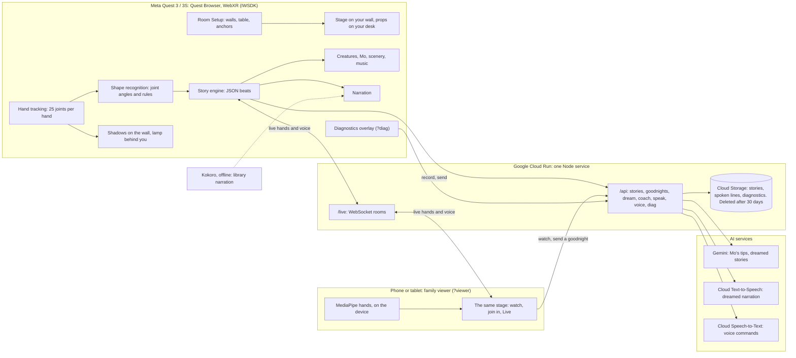

# Shadowplay: Bedtime Across the World

**Bedtime stories told with your hands, for a child who is far away.**

Hands only, no controllers. Seated. Works on any wall, or none.

<!-- Hero image: docs/hero.jpg, a still from the headset capture (added after the device sessions). -->

A parent puts on a Meta Quest and tells a shadow-puppet story on their own wall:
a virtual lamp behind them throws the shadows of their real, tracked hands, and when
they make a rabbit, a fish or a bird, the shadow comes alive in colour and carries
the story on. Their child, at home on a phone or tablet, watches it, plays along
with their own hands through the camera, and sends a goodnight back, with a
drawing and new colours for Mo.

For the soldier on deployment, the parent working in another country, the
grandparent across an ocean.

Built with [IWSDK](https://iwsdk.dev) (WebXR) for the Meta VR Start Developer
Competition 2026 (Entertainment track, New Experience division).

## Built on real Quest hardware, not just the emulator

Shadowplay was played and tuned on a **Meta Quest 3** and a **Meta Quest 3S**,
in a real room, with hand tracking only. Every headset session ran with
privacy-safe diagnostics (`?diag`), so each problem was found in the numbers,
fixed, and checked again on the headset.

**Smooth on both headsets.** Every session held the requested 72 Hz: median
71.5 to 72 fps, a frame-time 95th percentile around 15 ms, and not one
5-second window under 60 fps, on Quest 3 and Quest 3S alike.

**What real hands and real rooms taught us** (things an emulator cannot show):

| On the headset | What changed |
| --- | --- |
| Hands were in the lamp's light only about 15% of the time: the desk lamp stood where hands are naturally held, so shadows meant reaching far forward to a window about 14 x 9 cm | **The lamp moved behind you**, as in real shadow theatre, aimed once through your own hands: modelled over natural hand positions, 80% now cast their shadow on the stage (it was 2%) |
| The opening bird took 15 minutes: real birds are made with thumbs hooked and fingers relaxed, not the textbook pose | Shapes recognised **as people really make them**: hooked-thumb birds, relaxed fish, tilted snails, palms-up cupped hands, two-finger antlers. The same bird then woke in 6 seconds |
| A shape still missing after about a minute was given up | The story helps sooner, at 15, 30 and 45 seconds, and after 45 any hand held still in front of you wakes the creature |
| "Open your hands" waited 75 seconds: people open their hands flat, fingers together | Any open hand counts |
| Entering from the Quest's own Enter VR prompt kept every sound back for the first 50 seconds | The story waits on its line and asks for one pinch to turn the sound on |
| Creature voices were played but not heard over the room, while the narrator was | Each voice is now a small sound file, played exactly like the narration and as loud |
| The narrator read "Shh" as the letters S-H-H | Lines are written for the voice ("Hush") |
| Two narration lines could overlap when a shape was made mid-sentence; creatures on the desk bumped into each other; a dreamed fish swam through a forest | One line at a time; creatures stand side by side; a dreamed story moves to where each creature belongs |

The room side works on real Room Setup data: the stage finds a labelled wall
(or falls back to a floating paper screen) and the desk props stand on the
detected table, anchored so they are in the same place the next time.

**How the diagnostics work.** Opening the app with `?diag` adds a small overlay
and sends anonymous technical data: frame times, the quality level, hand
tracking and what the recognizer saw (including the measurements behind each
two-hand shape), room detection, story timings and the sound engine's state.
Never audio, video, names or family codes. `scripts/diag/pull.sh` turns a
session into a one-screen report: how long each request took, how often hands
were in the light, whether sound was running.

## Try it

| | |
| --- | --- |
| In a Meta Quest browser | https://shadowplay-1031148889398.us-central1.run.app (press **Enter XR**, or install it as an app from the browser menu: it then opens straight into the headset view) |
| Family viewer (phone, tablet, desktop) | https://shadowplay-1031148889398.us-central1.run.app/?viewer |

On first launch both sides come with a labelled sample family, so you can try
everything alone: the viewer has a story *from Dad* to watch and join in, and the
headset has a goodnight *from Mia* waiting (pinch the Shadow Journal on the desk,
then **Goodnights**).

### Your first minute

1. Open the link in the Quest Browser, press **Enter XR** and allow room access
   (it finds your wall and your desk).
2. **Keep the room lights on.** Shadowplay dims the room for you, and hand
   tracking needs light.
3. Put the controllers down. The lamp stands behind you, as in shadow theatre:
   hold a hand up in front of you, where it is comfortable, and Mo the moth
   follows your fingertip (the light settles to shine through your hands).
   When asked, make the shape the ghost hand shows and hold it a moment; the
   shadow comes alive. If you hear nothing, pinch once: the headset may be
   holding sound back.

Two fallbacks: with no wall straight ahead, the story plays on a floating paper
screen; if the stage lands somewhere odd, pinch the book on the desk, then
**Move stage here**, and look at the wall you want. If a shape will not come,
the story helps: after 15 and 30 seconds it is more forgiving, and after 45 any
hand held still in front of you will do.

## What it does

**In the headset (the storyteller)**
- A stage on your real wall, found from the room's detected planes (a floating
  paper screen when there is no usable wall, and **Move stage here** to put it
  where you look), with the room dimmed like a theatre and a twilight sky in
  each world's and scene's colours glowing behind the shadows.
- **The lamp is behind you**, as in shadow theatre: it stands on a small table
  behind your shoulder and is aimed once through your own hands, so a hand held
  where it is comfortable throws its shadow onto the stage (its switch is on
  the desk: pinch it to pause). Pull a hand back toward you and its shadow
  grows; in a search, the light follows your hand like a torch.
- **Creatures come alive**: in their own colour, with fireflies leaving the wall,
  a little voice each (a chirp, a bubble, a soft woof), and a quiet music-box
  lullaby under the story (**Music** in Settings). Mo flies off the wall and
  lands on your fingertip, and at the end falls asleep there. When you let a
  creature go, a glowing paper cut-out of it hops onto your desk. At the finale
  a window opens in the wall onto hills under the stars, and every story told
  to the end leaves a star in a jar beside the journal, kept from night to night.
- Eleven narrated stories in five **story worlds** (*Where should we go
  tonight?*), picked from the journal, each world with its own colours and sky:
  - *Wonder and Nature*: *The Moth Who Borrowed Light* (twenty minutes in
    chapters, a branching wolf encounter, a lighthouse finale), *The Letter
    That Took the Slow Way*, *The Brave Little Dog*, *Counting Stars* (three
    minutes, for the littlest ones), *The Night Garden*, *The Kind Crocodile*
    and *The Little Rainstorm*;
  - *Ocean and Exploration*: *Goodnight Across the Sea*, from the shore with a
    swan to a lighthouse;
  - *Cars and Adventure*: *Mo and the Midnight Moon Buggy*, on a moon road;
  - *Dinosaurs and Discovery*: *Mo and the Sleepy Little Dinosaur*, in a fern
    valley under a smoking volcano;
  - *Space and Exploration*: *Mo and the Little Lost Spaceship*, at a star port
    under a ringed planet.

  The newer stories each have their own narrator. Eleven hand shapes, from a
  rabbit to a two-handed crocodile, recognised as people really make them; the
  story never fails: it shows a ghost hand, waits, and becomes more forgiving.
- **Record a story** (hands, story and your voice: you are the narrator, the
  captions are your script) and **Send to family**: a private family code
  (three words and a number, like `lantern-otter-moss-417`), no accounts.
- **Go live**: your family joins with the code and sees your shadows on their
  screen in real time; talk to each other; **Take turns** so the child makes
  every other creature, which wakes in the child's own colour with their name.
- **Goodnights**: what your family sent back plays on your wall; Mo takes the
  colours the child chose, and the creature they drew walks onto the wall in
  the next story.
- **Dream a new one** (Tonight's story): Mo dreams up a new short story for a
  place (sea, forest, meadow, river, rain or sky) and two or three shapes the
  storyteller picks, in the order the story should ask for them (or say
  "dream a story about the river with a fish and a bird"). Gemini writes the
  narration lines; the app builds the story itself (the same pattern as
  Counting Stars) and checks every line, so it plays like any other story, with
  captions and a narrator's voice that says the child's name. A dreamed story
  can be recorded and sent, or told live, like any other: its words travel with
  it, and the server and the family's device check them again before it plays.
- Accessibility: recognition tolerance, show-me hints, one-hand mode and a
  high-contrast mode (black-and-white panels and captions, solid shadows on the
  wall), and **Look to press** for limited hand mobility: rest the centre of
  your view on a button, the journal or the lamp switch to press it, and look
  at the ghost hand to make a shape, so a whole story can be told without hands
  (head gaze: Quest 3 and 3S have no eye tracking). **Voice commands** are the
  spoken alternative: say the shape the story asks for, "open the journal",
  "pause", "continue", "go on", "music off" or a button's name. One-hand mode,
  forgiving shapes, high contrast, Look to press and Voice commands are also on
  the first screen, before entering XR.
- Pauses when you open the Quest menu or take the headset off, and picks up on
  the same line; a story left mid-way continues from its chapter next time.
  If the headset holds sound back (it does when you enter from the Quest's own
  Enter VR prompt rather than the page's button), the story waits on its line
  and asks for one pinch to turn the sound on; with no pinch it goes on with
  captions after a few seconds.

**On the phone or tablet (the family)**
- Watch a story someone recorded for you, in their voice, with your name in it.
- **Join in**: at each shape the story waits for *your* hands (camera, after a
  grown-up allows it).
- **Join live** with a family code; talk, show your hands, take turns.
- **Send a goodnight back**: twenty seconds of your shadow creature and, if a
  grown-up switches it on, your voice; choose colours for Mo, and draw a
  creature with your finger for the next story.

## How Shadowplay uses AI

AI helps the storyteller; it never replaces them, never sees the child, and
never puts a word on the wall that the app has not checked.

| | What it does | What it is given | Guardrails |
| --- | --- | --- | --- |
| **Mo the coach** (Gemini 3.5 Flash Lite) | When a hand is stuck on a shape, Mo gives one short, warm tip in about 0.7 s ("curl your ring finger down") | Only the shape's name and a few fixed facts the headset worked out from the hand's joints | The facts come from the app's own recognition, not from the model; the reply must fit them, pass the content checks (no brands, Mo is "she", no pose from another shape), or the app's own words are used |
| **Dream a new story** (Gemini 3.8 Flash) | A new bedtime story for the place and shapes the storyteller picks, in about 4 s | A theme and shape names, never names or anything typed or said | The model writes only lines of narration into a fixed shape; the app builds the story itself (scenes, requests, scenery that fits each creature), checks every line, and refuses anything off. Shared, it is checked again by the server and the family's device |
| **A voice for every line** | The library is read by five narrators recorded offline with **Kokoro**, an open model (Apache-2.0); a dreamed story is read live by **Google Cloud Text-to-Speech**, saying the child's name | Story lines only | Only plain story lines that pass the content checks are spoken; each is cached and deleted after 30 days. When a parent records, *they* are the narrator |
| **Voice commands** | Say the shape, "pause", "go on", "music off" | A spoken phrase of a second or two (the browser's own recognition, else **Google Cloud Speech-to-Text**) | Only on when switched on; the clip is forgotten; ignored while recording or talking live |
| **The child's hands** | The family viewer turns the phone's camera into hand positions with **MediaPipe**, on the device | Camera frames, on the device only | Video never leaves the device; a grown-up allows the camera first |

What is *not* AI: the hand-shape recognition in the headset is the app's own,
joint angles matched to templates and rules tuned on real headset sessions. It
is instant, works offline, explains itself (that is where Mo's facts come
from), and cannot be talked into a wrong answer.

The model provider is one setting on the server (`AI_PROVIDER`): Gemini for the
submission, with Claude and Meta's models also supported.

## Age rating: 10+

Bedtime stories meant to be shared by a grown-up and a child. The only peril is
gentle and resolves kindly: a wolf on the path runs away from a big shadow dog
or falls asleep under a shadow bird, a storm passes, a little dog is scared and
brave anyway. There is no violence, injury, frightening imagery, profanity,
romance, advertising or in-app purchase. The family side is set up by a grown-up,
who allows the camera and switches on the voice for a goodnight; shared stories
are private to the family and deleted after 30 days.

## Privacy and safety

- No accounts and no public listing. A shared story is reachable only by its
  private family code and is deleted after 30 days.
- The camera starts only after a grown-up allows it on that device. Video never
  leaves the device; only hand positions are used (and, in Live, sent).
- The microphone opens only when the person presses Record with voice or Talk,
  or turns on Voice commands. With Voice commands on, a short spoken phrase is
  understood by the browser's own speech recognition or, where the headset
  browser has none, sent to a speech-to-text service and forgotten; commands
  are ignored while a story is being recorded with voice or during Talk.
- Mo's tips: when someone is stuck on a shape, the app sends the server only
  the shape's name and a few fixed facts about the hand pose ("the ring finger
  should be curled down"), never names, video, audio or free text. Where the
  server has AI enabled, Google's Gemini words Mo's tip from those; otherwise
  the app's own words are used. Nothing is stored.
- A dreamed story: the app sends a theme and shape names only (never names or
  anything typed or said), and keeps the story on the device. Its lines are
  voiced by Google Cloud Text-to-Speech on the server; a line that names the
  child sends that first name with it. Each spoken line is kept in the story
  bucket by its words (not linked to any family) and deleted after 30 days.
- A goodnight's gifts travel with it, under the story's private code: Mo's
  colours as a palette name, and the child's drawing as finger strokes (a few
  kilobytes), both checked by the server.
- Live rooms hold one storyteller and one family member. The server relays only
  protocol messages and stores nothing.
- Uploads are strictly validated; rate limits and room limits are per client.
- Diagnostics are off unless the page is opened with `?diag`; then it sends
  anonymous technical data (frame times, quality level, recognition results,
  room detection, device type and error messages), never audio, video, names
  or family codes.

## How it works



- **Stage** (`src/stage-setup.ts`, `src/wall-choice.ts`): picks the wall straight
  ahead (labelled walls first, clear of doors and windows) or a paper screen;
  adaptive quality steps down in four levels if frames are missed, judged
  against the headset's refresh rate.
- **Light and reach** (`src/lamp-behind.ts`, `src/stage-runtime.ts`): the bulb
  stands about 65 cm behind the eyes and is aimed once through the viewer's own
  hands (modelled over natural hand positions: 80% throw their shadow on the
  stage, against 2% from a desk lamp in front). A hand meets the stage where
  its shadow falls, else where it is seen over the stage, else by its place in
  a performance zone in front of the viewer.
- **Recognition** (`src/hand-features.ts`, `src/recognition-rules.ts`): smoothed
  joint angles matched to per-shape templates, with pair rules for two-hand
  shapes and a resting-hand reject; a shape must be held half a second. When a
  story asks for a shape, a hand close to it counts even if a neighbouring
  shape fits a little better (tuned from Quest 3 and 3S sessions: hooked-thumb
  birds, relaxed fish, tilted snails, flat antlers, palms-up cups).
- **Performance stream** (`src/performance/`): both hands at 30 Hz in
  stage-relative millimetres, story beats, creature wakes and releases, lamp and
  staging events, plus voice. It replays on any stage, any size.
- **Live** (`src/live/`): the same events and 20 Hz hands over a WebSocket room;
  16 kHz voice through AudioWorklets with an adaptive jitter buffer; reconnects
  through dropouts (the room waits 45 s for the storyteller).
- **Server** (`server/`): one Node process (TypeScript run directly) serves the
  app, the sharing API and Live rooms; stories live on disk locally or in a Cloud
  Storage bucket in production, on Google Cloud Run.
- **Narration** is generated with [Kokoro](https://github.com/hexgrad/kokoro)
  (Apache-2.0), locally, by `scripts/narration/generate.py`, each story by its
  own narrator (named in `public/story/library.json`); recorded clips can
  replace it at any time. A line with no clip (a dreamed story) is spoken by
  the server (`server/speak.ts`, Google Cloud Text-to-Speech), fetched a few
  lines ahead.
- **Installable**: a web app manifest and icons; installed as an app (a WebXR
  PWA) it opens straight into the headset view.

## Credits and licences

The stories, characters, shadow puppets, lamp, scenery, music and sound effects
are original to Shadowplay (the sound is synthesised from simple waves, with no
recordings; the models are built in code). It uses:

| Work | Used for | Licence |
| --- | --- | --- |
| [Kokoro-82M](https://github.com/hexgrad/kokoro) (hexgrad) | the storyteller voice, generated offline into `public/narration/` | Apache-2.0 |
| [MediaPipe Hand Landmarker](https://ai.google.dev/edge/mediapipe/solutions/vision/hand_landmarker) (Google) | camera hands in the family viewer, on the device; see `public/models/NOTICE.md` | Apache-2.0 |
| [Gemini API](https://ai.google.dev/gemini-api) (Google) | words Mo's tips and dreamed stories, on the server (only shape names and fixed hand facts are sent) | Gemini API Terms of Service |
| [Cloud Speech-to-Text](https://cloud.google.com/speech-to-text) (Google) | voice commands when the headset browser has no speech recognition (short clips, not stored) | Google Cloud Terms of Service |
| [Cloud Text-to-Speech](https://cloud.google.com/text-to-speech) (Google) | the narrator's voice for dreamed stories, on the server | Google Cloud Terms of Service |
| [Inter](https://rsms.me/inter/) (The Inter Project Authors) | typeface of the headset panels (via `@pmndrs/msdfonts`) | SIL OFL 1.1 |
| [Lucide](https://lucide.dev) (Lucide Contributors) | two interface icons | ISC |
| [three.js](https://threejs.org) | 3D rendering | MIT |
| [Immersive Web SDK](https://github.com/facebook/immersive-web-sdk) (Meta Platforms, Inc.) | WebXR framework | MIT |
| [uikit](https://github.com/pmndrs/uikit) (Bela Bohlender) | headset user interface | MIT |

The same list is in the app: **Credits** on the first screen and in the family viewer.

## Develop

```sh
npm install
npm run dev        # IWSDK dev server + managed browser with the Quest emulator (https://localhost:8082)
npm run server     # sharing API and Live rooms on :8787 (the dev server proxies /api and /live)
npm test           # typecheck, unit tests (every story: content checks, scenery that fits its world, narration clips), server tests, recognition sweep
```

`iwsdk.config.json` is the project authority (scene, assets, XR features);
systems are registered in `src/index.ts`. See `AGENTS.md` for IWSDK conventions.

### Simulations (no headset, no second person)

Everything family-facing was tested without a Quest or a second person, using
headless browsers, the IWSDK emulator and Chrome's fake camera and microphone
(files, never real devices). With the dev server running:

| Script | What it proves |
| --- | --- |
| `node scripts/sim/live-family.mjs` | A parent and a child in two browsers through a degraded network (delay, jitter, a dropout): story sync, hands, voice both ways, duet turns, reconnects |
| `node scripts/sim/voice-lab.mjs` | Mouth-to-ear voice delay per network condition (56 ms on a clean line) |
| `node scripts/sim/playtest.mjs` | Bot children (perfect, small hands, shaky, wrong shape first, slow, wanderer) play the whole story: no stalls, help arrives; fails if draw calls, triangles or shadow casters exceed the budget |
| `node scripts/sim/rooms.mjs` | Room cases with fake planes: no planes, floor only, walls too close, too far or at a steep angle, doors and windows, a desk found or not, late room data, recenter, Move stage here by pinch |
| `node scripts/sim/session-life.mjs` | First-screen options, Quest menu and headset off mid-line, the first ghost hand, continuing next launch |
| `node scripts/sim/hands-only.mjs` | Every interaction with emulated hands and no controllers: journal and lamp switch by pinch, every panel button by hand ray |
| `node scripts/sim/narration-stall.mjs` | A narration clip whose download stalls does not stall the story |
| `node scripts/sim/narration-overlap.mjs` | Narration never plays two lines at once (dreamed and library stories, shapes made while a line is still being read) |
| `node scripts/sim/first-minutes.mjs` | Time from Enter XR to the first creature on a first launch |
| `node scripts/sim/comfortable-hands.mjs` | Hands held where people hold them (not in the lamp's beam): every story with a shape told to the end, each shape in under a second |
| `node scripts/sim/lamp-behind.mjs` | The lamp behind the viewer, its switch on the desk, the light aimed through the viewer's hands |
| `node scripts/sim/never-stuck.mjs` | A shaky hand that never makes the shape still gets the creature from the story's last help |
| `node scripts/sim/new-stories.mjs`, `story-worlds.mjs`, `dino-space.mjs` | The newer stories told to the end with their narration; choosing each story world by hand ray, its scenery, and the dinosaur and spaceship going home at the finale |
| `node scripts/sim/sound-unlock.mjs` | Sound held back until a gesture: the story waits on its line, a pinch plays it, captions carry on without one |
| `node scripts/sim/dream-stories.mjs`, `dream-voice.mjs`, `share-dreamed.mjs` | Dreaming a story (place and shapes), its narrator's voice with the child's name, recording and sending it |
| `node scripts/sim/sound.mjs` | The lullaby under the story (quieter under the narrator, silent while recording with voice), each creature's voice |
| `node scripts/sim/keepsakes.mjs`, `lanterns.mjs`, `wall-window.mjs`, `mo-visit.mjs` | The star jar kept from night to night, creatures on the desk, the window at the finale, Mo on the fingertip |
| `node scripts/sim/child-gifts.mjs` | A goodnight's gifts: Mo's colours and a drawn creature, from the family viewer to the wall |
| `node scripts/sim/pwa.mjs` | The web app manifest and icons; installed, it opens straight into XR |
| `node scripts/sim/smoke.mjs <url>` | A deployed site end to end, including the family viewer and diagnostics in a browser |

Peak load measured through a whole story at full quality: about 95 draw calls
and 38k triangles, with a budget enforced by the playtest. On the headsets, every
`?diag` session on Quest 3 and Quest 3S held the requested 72 Hz (median 71.5 to
72 fps, no 5-second window under 60 fps).

### Device testing

Open the app with `?diag` for an overlay under the stage (frame times, quality
level, hands and recognition, room detection) and diagnostics sent to the
server: numbers and short identifiers only, never audio, video or names. Without
`?diag` none of it loads. After a session, `scripts/diag/pull.sh` fetches and
summarizes it. Builds for headset sessions deploy beside the public one with
their own URL; the checklist is [docs/DEVICE-TEST.md](docs/DEVICE-TEST.md).

## Status

Complete and deployed, and hardened for the competition: diagnostics,
performance, cold start (about 560 KB to first render), recognition, untested
rooms, the first five minutes, and compliance with the rules. Tested in the IWSDK
Quest emulator, in simulation, and on Meta Quest 3 and Quest 3S (`?diag`
sessions, November 2026), with recognition, the lamp, narration and sound tuned
from those sessions.
